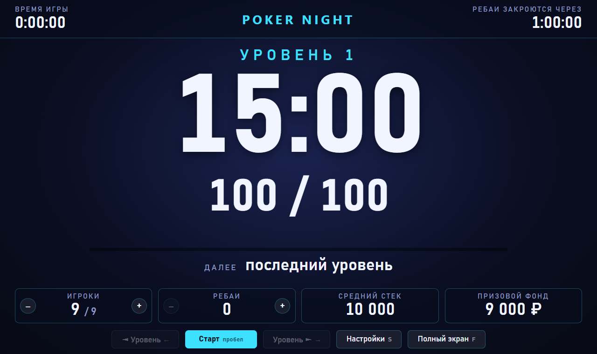
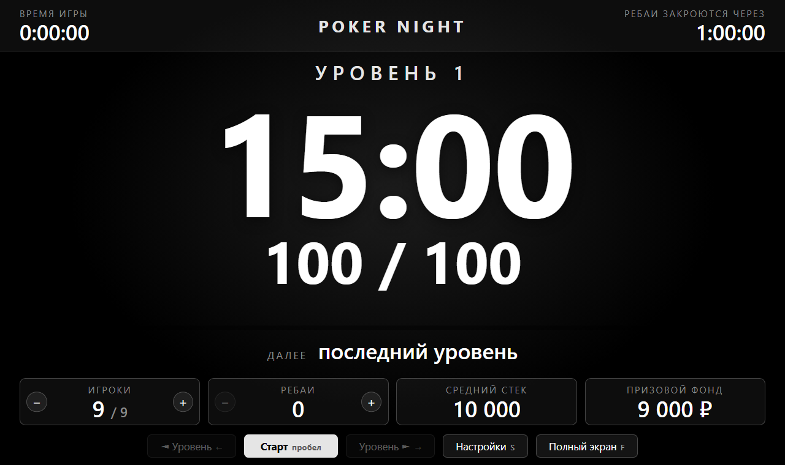
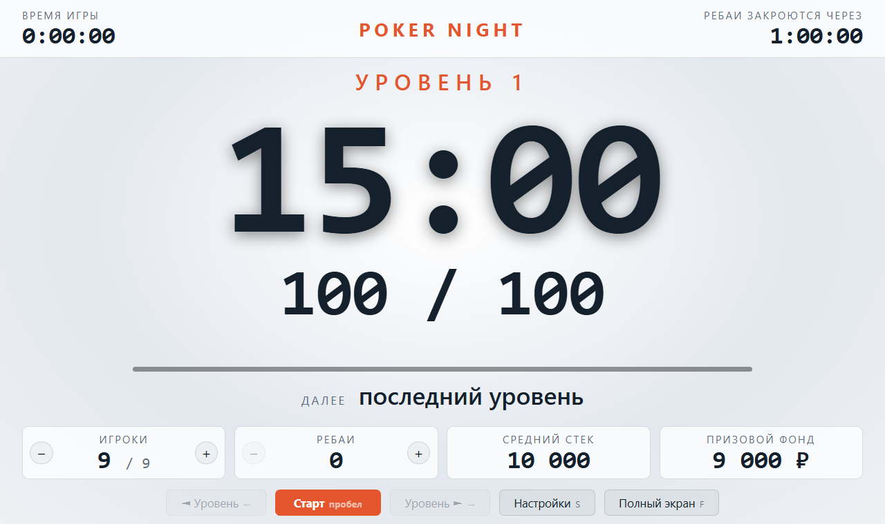

# Таймер для покера

Таймер для домашних турниров в покер: уровни блайндов, анте, перерывы, игроки, ребаи, призовой фонд.
Работает в браузере и без интернета, языки: русский, English, עברית.





## Как открыть по ссылке (телевизор, телефон, компьютер)

Страница опубликована через GitHub Pages:

**https://istina85.github.io/poker-timer/**

Откройте ссылку в браузере устройства (на телевизоре — во встроенном браузере Smart TV или через телефон/ПК, если телевизор умеет зеркалирование). Для полного экрана нажмите **F** (или кнопку «Полный экран»).

Настройки сохраняются в браузере устройства. С другого устройства настройки свои.

## Как запустить с флешки (Windows, без установки)

1. Скачайте архив `Poker-Night-Windows.zip` (раздел **Releases** в репозитории) и распакуйте.
2. Скопируйте папку **Poker Night** на флешку.
3. Откройте **Poker Night.exe** двойным щелчком.

Нужны: Windows 10/11 и Microsoft Edge (он есть в системе) или Google Chrome.
Права администратора и интернет не нужны. Настройки хранятся в файле `settings.json` рядом с программой, поэтому переносятся вместе с флешкой; временные данные браузера создаются на компьютере и удаляются после закрытия окна.

Если `index.html` и `Poker Night.exe` лежат в одной папке, программа открывает таймер из неё же.

## Настройки

- **Язык** — в правом верхнем углу окна настроек: Русский, English, עברית.
- **Тема оформления** — 10 тем, в том числе чёрная.
- **Структура блайндов** — старт малый/большой, минимальная фишка, длина уровня,
  режим «закончить турнир за N ч» (таймер сам подбирает рост блайндов), перерывы,
  столбец «От старта» показывает время до конца каждого уровня.
- **Выводить банк** — показывать ли призовой фонд на главном экране.

Клавиши: пробел — старт/пауза, ← → — уровень, S — настройки, F — полный экран.

## Для разработчика

Весь таймер — один файл `index.html`, без сборки и внешних зависимостей.

Сборка Windows-версии (нужны только компоненты Windows, .NET Framework 4):

```bash
powershell -ExecutionPolicy Bypass -File windows\build.ps1
```

Результат: `dist/Poker Night/` и `dist/Poker-Night-Windows.zip`. Папка `dist/` в git не хранится.

Состав: `index.html` (страница), `windows/` (программа-запускатор и сборка), `screenshots/` (скриншоты для README).
